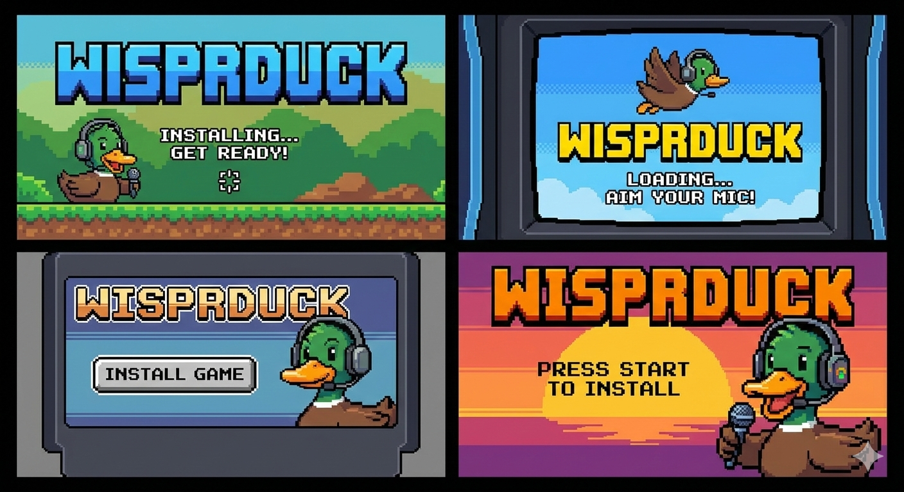

<p align="center">
  
</p>

<h1 align="center">Shhh... Ducking Volume</h1>

<p align="center">
  <strong>Auto-duck background audio when your mic is active.</strong><br>
  A lightweight macOS menu bar utility for voice-to-text, calls, and recording.
</p>

<p align="center">
  <a href="../../releases/latest"></a>
  
  
</p>

---

## What is WisprDuck?

WisprDuck sits in your menu bar and watches for microphone activity. When a selected app starts using the mic — voice-to-text tools like [Wispr Flow](https://wispr.com), video calls, screen recordings — WisprDuck automatically lowers the volume of other apps so your voice comes through clearly. When the mic goes idle, volume smoothly fades back up.

No manual toggling. No keyboard shortcuts. Just works.

## Features

- **Per-app mic triggers** — choose which apps trigger ducking (e.g., only Wispr Flow) or duck on any mic use
- **Per-app duck targets** — duck all audio or pick specific apps (Spotify, Chrome, Arc, etc.)
- **Smart defaults** — Wispr Flow pre-selected as trigger, 20+ common audio apps pre-selected as duck targets
- **Smooth linear fade** — 1-second constant-rate volume transitions, no harsh jumps
- **Crash-safe** — uses `mutedWhenTapped` so audio auto-restores if WisprDuck quits unexpectedly
- **Lightweight** — event-driven Core Audio listeners, no polling, minimal CPU usage
- **Smart grouping** — Chrome helpers, Slack workers, etc. automatically group under their parent app

## Installation

1. Clone the repo and [build from source](#building-from-source), or download a build from the [releases page](../../releases/latest)
2. Drag **WisprDuck.app** to `/Applications`
3. Launch WisprDuck
4. On first launch: right-click the app → **Open** (required for unsigned apps)
5. Grant **microphone access** when prompted
6. Grant **Screen & System Audio Recording** access (audio-only is supported)
   - If you don’t see the prompt, open System Settings → Privacy & Security → Screen & System Audio Recording and enable WisprDuck.

> WisprDuck runs as a menu bar app — no Dock icon. Look for the duck foot in your menu bar.

## How It Works

WisprDuck uses [Core Audio process taps](https://developer.apple.com/documentation/coreaudio) (macOS 14.2+) to intercept audio at the system level. When a trigger app activates the mic:

1. **Detect** — Per-process Core Audio listeners detect which app is using the mic input
2. **Match** — The active mic app is checked against your trigger list (or triggers on any mic use)
3. **Tap** — Process taps are created for target apps, muting their original audio at the system mixer
4. **Scale** — The intercepted audio is scaled by the duck level and played through an aggregate device
5. **Restore** — When the mic goes idle, volume linearly ramps back to 100% over ~1 second, then taps are destroyed

The `mutedWhenTapped` behavior is the safety net: if WisprDuck crashes or is force-quit, macOS automatically unmutes all tapped processes. Audio is never permanently stuck at a low volume.

## Configuration

Click the duck foot icon in your menu bar:

| Setting | Description |
|---------|-------------|
| **Enable Monitoring** | Toggle WisprDuck on/off |
| **Duck Level** | Target volume when ducked — 0% is silent, 100% is full volume (default 10%) |
| **Trigger All Apps** | Duck when any app records from the mic, or toggle off to pick specific trigger apps |
| **Duck All Apps** | Duck every app that is playing audio, or toggle off to pick specific apps to duck |

**Trigger All Apps** uses per-process mic input only, so playback through an audio interface with inputs (for example a Focusrite Scarlett) does not count as mic use. **Duck All Apps** skips system audio daemons, and it picks up an app that starts playing during a dictation within about 0.5 s.

## Using with Granola Voice Typing

[Granola](https://granola.ai) Voice Typing (hold `fn`, speak, release) works as a trigger:

1. Turn on Voice Typing in Granola: **Settings → Voice typing**.
2. Dictate once, so Granola appears in WisprDuck's trigger list.
3. Open the WisprDuck menu, turn off **Trigger All Apps**, and turn on **Granola**.

Granola records in a helper process (`Granola Helper`). WisprDuck resolves the helper to `com.granola.app`, so selecting Granola is enough. Granola opens the mic about 0.3 s after you press the shortcut and closes it within about 0.5 s after you release it, so ducking follows each dictation.

> **Meetings:** Granola also uses the mic for the whole length of meeting transcription. With Granola selected as a trigger, WisprDuck ducks your target apps for the whole meeting. Browsers are default duck targets, so a browser meeting (Google Meet, etc.) also gets quieter. Granola is not a default trigger for this reason. If you use Granola for meetings, remove your meeting app or browser from the duck targets, or turn off the Granola trigger during meetings.

> **Shortcut conflict:** Wispr Flow and Granola both use `fn` by default. If both apps are running, change one shortcut.

### Checking any dictation app

`scripts/mic-probe.sh` shows which processes use the mic, the app bundle IDs that WisprDuck sees for them, and whether your current trigger settings would duck. It uses the app's own matching code.

```bash
./scripts/mic-probe.sh --seconds 20 --trigger com.granola.app
```

Start and stop a dictation while it runs. Example output for Granola:

```text
[10:28:28.882] mic in use by 1 process(es) → WisprDuck would DUCK
  pid 48903 Granola Helper
    ancestry: com.granola.app
    root app: com.granola.app
[10:28:32.626] mic idle → WisprDuck would not duck
```

## Requirements

- **macOS 14.2+** (Sonoma) — required for Core Audio process taps
- **Microphone permission** — required to access microphone state on macOS
- **Screen & System Audio Recording permission** — required to capture and scale other apps’ audio (audio-only is supported)

## Building from Source

```bash
git clone https://github.com/kalepail/wispr-duck.git
cd wispr-duck
open WisprDuck.xcodeproj
```

Build and Run with **Cmd+R** in Xcode. Requires Xcode 15+ with the macOS 14.2+ SDK.

For command-line verification:

```bash
./scripts/verify.sh
```

That validates plist/project files, runs the unit tests, builds the mic probe, builds the native app in Debug and Release with signing disabled, and runs the site lint/build checks.

To run only the unit tests:

```bash
xcodebuild -project WisprDuck.xcodeproj -scheme WisprDuck CODE_SIGNING_ALLOWED=NO test
```

The `WisprDuckTests` bundle compiles the app's non-UI sources directly and replaces Core Audio with fakes, so it does not launch the app, touch your audio, or read your saved settings. It covers trigger matching (including Granola and Wispr Flow helpers), the gain ramp, settings and migrations, tap lifecycle, and the duck/restore state machine.

To see WisprDuck's duck and restore decisions live:

```bash
log stream --level info --predicate 'subsystem == "com.wisprduck"'
```

## Release Builds

Create a reproducible unsigned zip locally:

```bash
./scripts/build-release.sh
```

The script writes `build/release/WisprDuck-<version>-<build>.zip` plus a SHA-256 checksum. By default the build number is the current git commit count; set `BUILD_NUMBER=...` to reproduce a specific release build. Set `CODE_SIGNING_ALLOWED=YES` and the usual Xcode signing environment when building from a machine with the Developer ID certificate installed.

## License

Apache 2.0 — see [LICENSE](LICENSE) for details.
